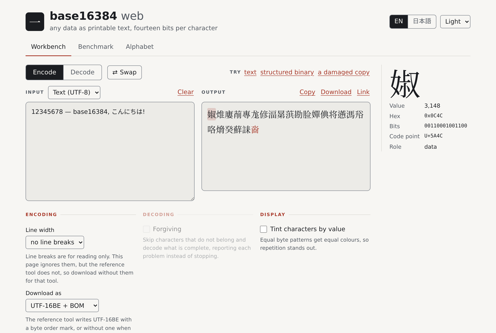
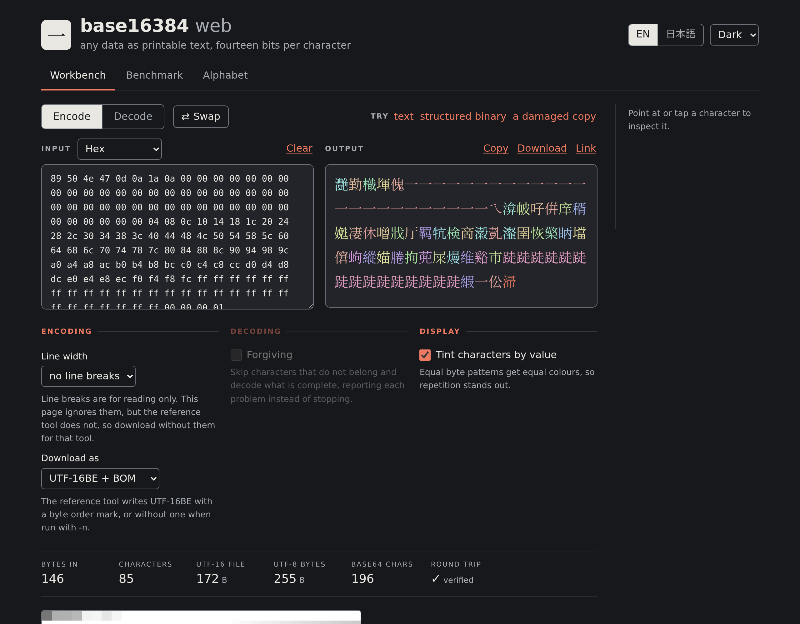
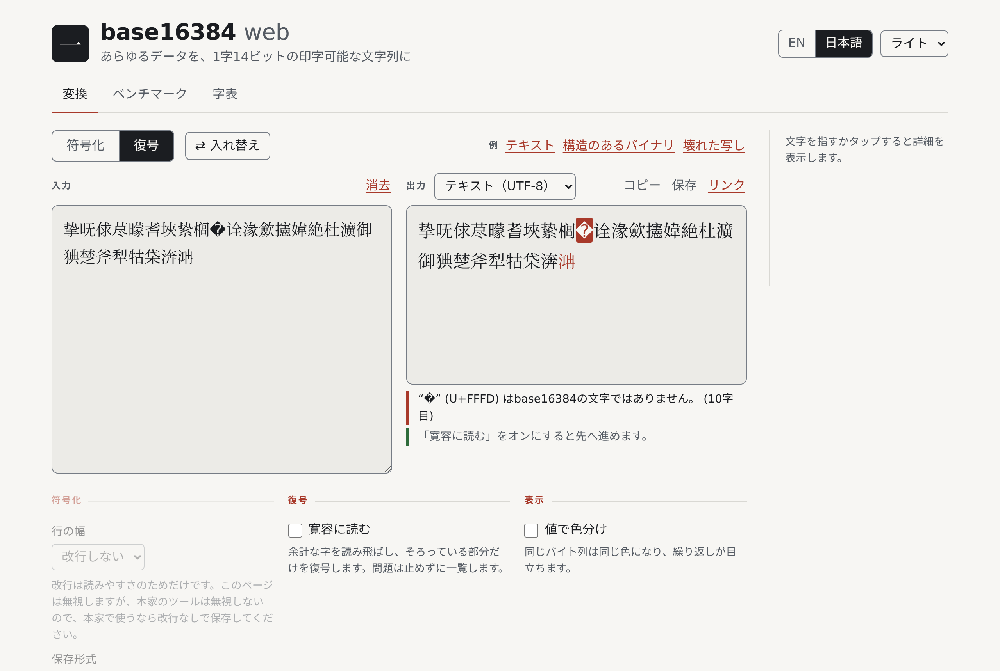
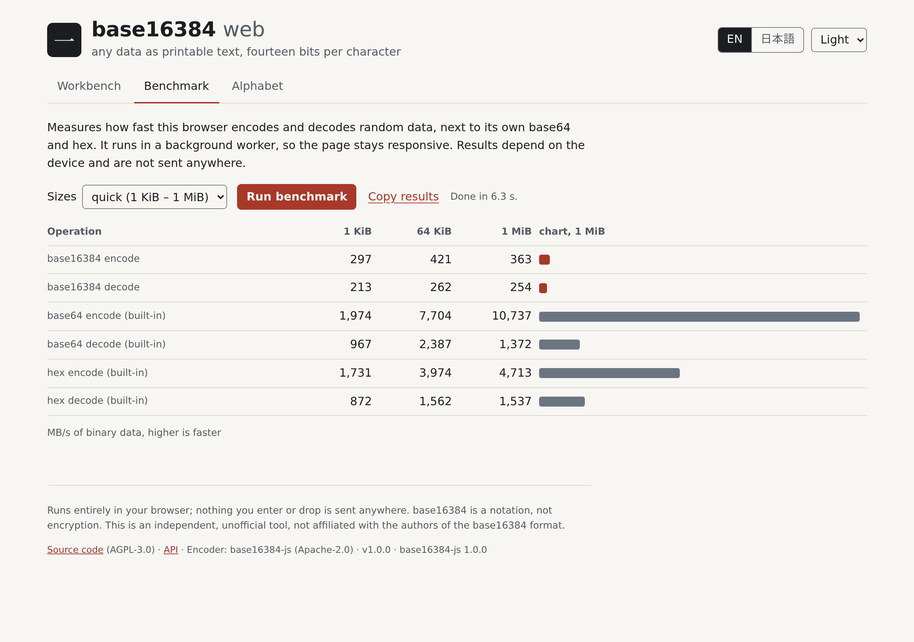
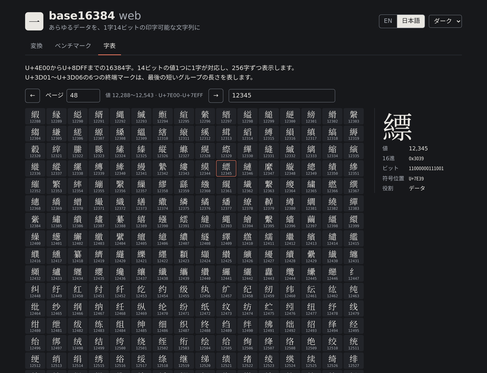
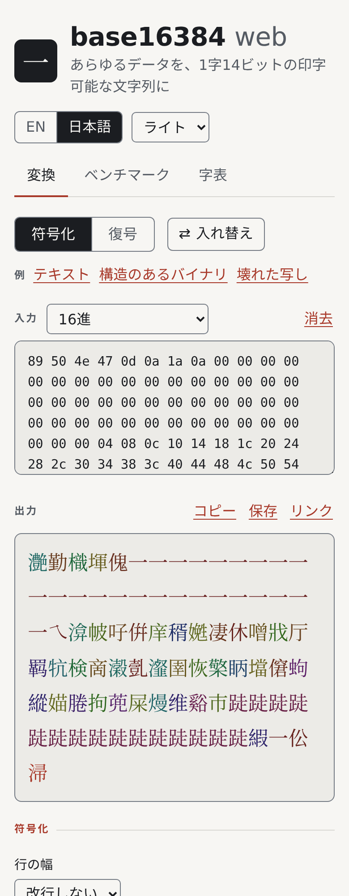

# base16384 web

Encode and decode base16384 in your browser: files, text, hex and base64, with a byte map, an alphabet browser and a speed benchmark.

**Open it: <https://didvc.github.io/base16384-web/>** Everything runs in the page. Nothing you type or drop is uploaded.

base16384 writes any data as printable text, 14 bits per character, using the 16384 code points from U+4E00 to U+8DFF. Seven bytes become four characters. Counted in characters, the result is about a quarter the length of hex and under half that of base64. The text is compatible with the reference command-line tool: files from that tool open here, and files saved here open in it.

## Encoding

Choose Encode, then type text, paste hex or base64, or drop a file. The result appears as you type, and a round-trip check confirms it decodes back to the same bytes.

Download saves the text in the format you pick:

- UTF-16BE with a byte order mark, which is what the reference tool writes;
- UTF-16BE without the mark, like the tool's `-n` option;
- UTF-8, for pasting into documents and messages.

Line width breaks long output into lines for reading. This page ignores line breaks when decoding, but the reference tool does not, so leave them out of files meant for that tool.

The byte map under the statistics draws one square per byte, from white for 00 to black for FF. Headers, runs of zeros and repeated blocks are visible at a glance. “Tint characters by value” gives equal 14-bit values equal colours, so repetition stands out in the text itself.

## Decoding

Choose Decode and paste base16384 text, or drop a file. Files in UTF-16BE (with or without a byte order mark), UTF-16LE and UTF-8 are recognised. Spaces and line breaks are ignored. The decoded bytes are shown as text, hex or base64, and Download saves them as a file.

Damaged text is reported instead of silently decoded. The page highlights the offending character, gives its position and code point, and says what is wrong: a character that does not belong, a missing or inconsistent end marker, or something after the end. Tick “Forgiving” to skip what cannot be read and decode the rest, with every problem listed as a warning.

Point at, tap, or move with the arrow keys through any character to see its value in decimal, hex and binary, and its code point.

## Benchmark

The Benchmark tab measures how fast your browser encodes and decodes random data of 1 KiB to 1 MiB (or up to 16 MiB in the full run). It compares the result with the browser's own base64 and hex. Where the browser has native base64 or hex functions they are used and labelled built-in; otherwise a JavaScript fallback is measured and labelled as such. The run happens in a background worker, so the page stays usable. Copy results gives a Markdown table.

The numbers describe your device and browser at that moment. The encoder is plain JavaScript, so it is slower than native base64 but fast enough for any file a person would pick.

## Alphabet

The Alphabet tab shows all 16384 characters, 256 per page, each with its value. Search by value (`12345`), character, or code point (`U+7E39`) to jump to it. The six end markers U+3D01 to U+3D06, which record the length of a short final group, are listed below the grid.

## Links and the API

The Link button copies an address that reopens the page with the same input and settings. Files, and inputs longer than a few thousand characters, are left out of the link.

[`api/`](https://didvc.github.io/base16384-web/api/) answers requests such as `api/?op=encode&text=12345678` with JSON. It is computed in the browser, so a browser or a headless browser gets the JSON, while a plain HTTP client gets a usage guide.

The page has a light and a dark theme that follow the system unless you pick one. It also has English and Japanese text, and works on a phone.

## Compatibility

The encoder is base16384-js, an independent implementation that has been checked against the reference tool 2.3.2 in both directions. Two differences are worth knowing. This page tolerates whitespace and rejects damaged input, while the reference tool reads both as data. The reference tool's optional checksum (`-c`) is not supported. The full list is in the base16384-js documentation.

## Running it yourself

The site is static files. Serve the folder with any web server (`make serve` uses one on port 8000) and open it; module scripts do not load from `file://` addresses. `make test` runs the API tests. With `BROWSER` set to a headless-capable browser, `make check` loads every page and checks the main functions, and `make images` retakes the screenshots.

## Licence

This web app is licensed under the GNU Affero General Public License, version 3 or later ([LICENSE](LICENSE)). If you run a modified version for others, you must offer them its source. The bundled encoder in `vendor/` is base16384-js by the same author, under the Apache License 2.0 ([vendor/LICENSE-base16384-js](vendor/LICENSE-base16384-js)).

## Citing

See [CITATION.cff](CITATION.cff).

## Disclaimer

This is an independent, unofficial tool. It is not affiliated with or endorsed by the authors of the base16384 format or of the reference tool.

base16384 is a way of writing data down. It does not encrypt, hide or authenticate anything, and anyone can decode it. The software is provided as is, without warranty of any kind; see the licence for the full terms. Benchmark figures depend on the device and browser and are shown for comparison only.
